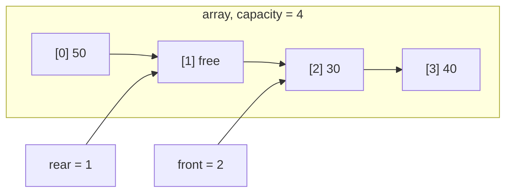
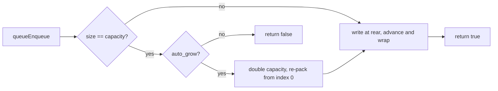

# C Circular Queue

[](https://en.wikipedia.org/wiki/C99)
[](LICENSE)

[中文文档](README_zh.md)

## Introduction

A circular queue written in C99. It began as a data-structure exercise and ended up with the features I keep reaching for in real code: an array-backed ring buffer, automatic capacity growth, an optional fixed-capacity mode, and reserve/shrink for long-running programs. The implementation is one header and one source file; the demo and tests sit next to them.

Elements live in a plain array. `front` and `rear` wrap around the end, so slots released by dequeue are reused instead of leaking away. A separate `size` field makes the empty/full check straightforward, and no slot has to be sacrificed. The default capacity is 8 and doubles when the queue is full. A queue created with `queueCreateFixed` never grows and simply rejects enqueue once it is full.

Here is a queue that has already wrapped around:



The logical order is 30, 40, 50, and `rear` points at the next slot to write. When the queue is full, enqueue either doubles the buffer or fails:



Reads go through an out-parameter:

```c
Data v;
if (queuePeek(q, &v)) {
    printf("%d\n", v);
}
```

An empty queue returns false and leaves `v` untouched, so there is no guessing whether `0` is data or an error. `queuePeekRear` follows the same rule. `queueShrink` hands unused memory back after the queue drains; not calling it costs memory but never correctness.

## Dependencies

A C99 compiler is all that is required. GNU Make is optional; plain compiler commands are listed under [Usage](#usage).

[](https://gcc.gnu.org/)
[](https://clang.llvm.org/)
[](https://www.gnu.org/software/make/)

| Header | Used for |
| --- | --- |
| `<stdio.h>` | `queuePrint` |
| `<stdlib.h>` | `malloc` / `free` |
| `<stdbool.h>` | `bool` |
| `<limits.h>` | `INT_MAX` overflow guard |

## Project structure

```
.
├── queue.h           # types and API declarations
├── queue.c           # queue implementation
├── demo.c            # demo program
├── tests/
│   └── test_queue.c  # unit tests and randomized reference test
├── Makefile
├── README.md         # English (primary)
├── README_zh.md      # Chinese (optional)
└── LICENSE
```

## Usage

### Build and run

```bash
make          # build demo and tests
make test     # run tests
make run      # run the demo
make clean    # remove build artifacts
```

On Windows use `mingw32-make` with the same targets. Without Make, call the compiler directly:

```bash
gcc -std=c99 -Wall -Wextra -O2 -I. -o demo demo.c queue.c
gcc -std=c99 -Wall -Wextra -O2 -I. -o test_queue tests/test_queue.c queue.c
```

### Example

```c
#include "queue.h"
#include <stdio.h>

int main(void) {
    Queue *q = queueCreate();        /* capacity 8, grows automatically */

    queueEnqueue(q, 10);
    queueEnqueue(q, 20);
    queueEnqueue(q, 30);

    Data head;
    if (queuePeek(q, &head)) {
        printf("front: %d\n", head);
    }

    queueDequeue(q);
    queuePrint(q);                   /* [20, 30] size=2 capacity=8 */

    queueDestroy(q);
    return 0;
}
```

### API

Create and destroy:

| Function | Description |
| --- | --- |
| `Queue *queueCreate(void)` | Queue with capacity 8 and auto growth |
| `Queue *queueCreateWithCapacity(int initial_capacity)` | Queue with a given initial capacity |
| `Queue *queueCreateFixed(int capacity)` | Fixed-capacity queue |
| `void queueDestroy(Queue *q)` | Destroy the queue and free memory |

Enqueue, dequeue and peek:

| Function | Description |
| --- | --- |
| `bool queueEnqueue(Queue *q, Data val)` | Enqueue, false on failure |
| `bool queueDequeue(Queue *q)` | Dequeue, false when empty |
| `bool queuePeek(const Queue *q, Data *out)` | Read the front element |
| `bool queuePeekRear(const Queue *q, Data *out)` | Read the rear element |

State and capacity:

| Function | Description |
| --- | --- |
| `bool queueIsEmpty(const Queue *q)` | True when empty; NULL counts as empty |
| `bool queueIsFull(const Queue *q)` | True when full |
| `int queueSize(const Queue *q)` | Current element count |
| `int queueCapacity(const Queue *q)` | Current capacity |
| `bool queueReserve(Queue *q, int capacity)` | Grow to at least `capacity` |
| `bool queueShrink(Queue *q)` | Shrink to element count, minimum 8; false for fixed queues |
| `void queueClear(Queue *q)` | Remove all elements, keep allocated memory |

Lookup and printing:

| Function | Description |
| --- | --- |
| `bool queueContains(const Queue *q, Data val)` | Check whether a value exists |
| `int queueCount(const Queue *q, Data val)` | Count occurrences of a value |
| `void queuePrint(const Queue *q)` | Print from front to rear |

### Switching the element type

Change two lines in [queue.h](queue.h):

```c
typedef double Data;
#define QUEUE_DATA_FORMAT "%.2f"
```

Elements are copied by value. If `Data` is a pointer the queue stores the pointer only and does not own the object, so deep copies have to be handled before enqueue.

### Complexity

| Operation | Time | Space |
| --- | --- | --- |
| Enqueue | amortized O(1), O(n) on resize | O(1) |
| Dequeue | O(1) | O(1) |
| Peek front / rear | O(1) | O(1) |
| Lookup / count | O(n) | O(1) |
| Resize | O(n) | O(n) |

A few implementation notes:

- `size` is tracked separately, so empty and full checks do not need a spare slot.
- `rear` points at the next write slot; enqueue and dequeue use an increment-and-compare instead of a modulo.
- Resizing re-packs elements from `front` to `rear` and resets `front` to 0.
- Growth checks `INT_MAX / 2` before doubling.
- Read-only APIs take `const Queue *`.

## Contributing

1. Fork the repository and branch off `main`.
2. Run `make test` before opening a pull request; add tests for new behavior.
3. Keep commit messages factual: what changed and why.
4. For bugs, open an issue with the compiler, platform, and a minimal reproduction.

## Contact

**Dr. Ailan Anjuxi (谙弆悕)**

- 📫 Email: anjuxi.ME@outlook.com
- 📞 SIP: sip:anjuxi@sip.linphone.org

## License

MIT License, see [LICENSE](LICENSE).
