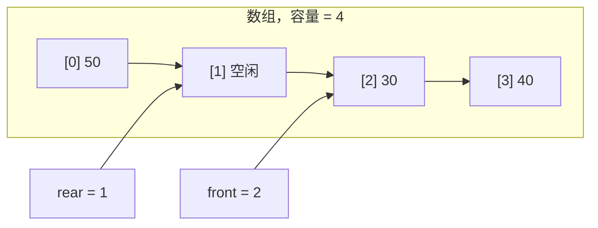
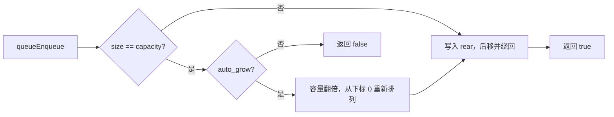

# C 语言循环队列

[](https://en.wikipedia.org/wiki/C99)
[](LICENSE)

[English](README.md)

## 项目介绍

用 C99 写的循环队列，最早是一个数据结构练习，后来把实际写代码时常用的几样东西补了进来：数组实现的环形缓冲、自动扩容、可选的固定容量模式，以及给长期运行的程序准备的扩容和缩容接口。实现只有一个头文件和一个源文件，旁边放演示程序和测试。

元素存在一个普通数组里，front 和 rear 绕到数组末尾后会回到开头，出队腾出来的位置能被后面的入队继续使用。元素个数用 size 单独记着，队空和队满的判断都很直接，也不用刻意空出一个槽。默认容量是 8，满了翻倍；`queueCreateFixed` 创建的队列不扩容，满了以后入队直接失败。

下面是一个已经绕过一圈的队列：



逻辑顺序是 30、40、50，rear 指向下一个可以写入的位置。队列满时，入队要么翻倍扩容，要么直接失败：



读取元素用出参：

```c
Data v;
if (queuePeek(q, &v)) {
    printf("%d\n", v);
}
```

空队列返回 false，v 不会被改写，不用去猜 `0` 到底是数据还是出错。`queuePeekRear` 的规则一样。元素变少后可以调用 `queueShrink` 把多余内存还回去，不调用只会多占一点内存，不影响正确性。

## 依赖说明

只需要一个支持 C99 的编译器。GNU Make 是可选的，不用 Make 时可以直接调用编译器，命令见“使用说明”。

[](https://gcc.gnu.org/)
[](https://clang.llvm.org/)
[](https://www.gnu.org/software/make/)

| 头文件 | 用途 |
| --- | --- |
| `<stdio.h>` | `queuePrint` 输出 |
| `<stdlib.h>` | `malloc` / `free` |
| `<stdbool.h>` | `bool` 类型 |
| `<limits.h>` | 扩容时的 `INT_MAX` 上限检查 |

## 项目结构

```
.
├── queue.h           # 类型定义与接口声明
├── queue.c           # 队列实现
├── demo.c            # 演示程序
├── tests/
│   └── test_queue.c  # 单元测试与随机操作对照测试
├── Makefile
├── README.md         # 英文文档（主文档）
├── README_zh.md      # 中文文档（可选）
└── LICENSE
```

## 使用说明

### 编译与运行

```bash
make          # 编译 demo 和测试
make test     # 运行测试
make run      # 运行演示
make clean    # 清理编译产物
```

Windows 下把 `make` 换成 `mingw32-make`，目标名不变。不想用 Makefile 的话，直接调用编译器：

```bash
gcc -std=c99 -Wall -Wextra -O2 -I. -o demo demo.c queue.c
gcc -std=c99 -Wall -Wextra -O2 -I. -o test_queue tests/test_queue.c queue.c
```

### 示例

```c
#include "queue.h"
#include <stdio.h>

int main(void) {
    Queue *q = queueCreate();        /* 默认容量 8，满了自动翻倍 */

    queueEnqueue(q, 10);
    queueEnqueue(q, 20);
    queueEnqueue(q, 30);

    Data head;
    if (queuePeek(q, &head)) {
        printf("队头: %d\n", head);
    }

    queueDequeue(q);
    queuePrint(q);                   /* [20, 30] size=2 capacity=8 */

    queueDestroy(q);
    return 0;
}
```

### 接口

创建与销毁：

| 函数 | 说明 |
| --- | --- |
| `Queue *queueCreate(void)` | 创建队列，容量 8，自动扩容 |
| `Queue *queueCreateWithCapacity(int initial_capacity)` | 指定初始容量，自动扩容 |
| `Queue *queueCreateFixed(int capacity)` | 创建固定容量队列 |
| `void queueDestroy(Queue *q)` | 销毁队列并释放内存 |

入队、出队与读取：

| 函数 | 说明 |
| --- | --- |
| `bool queueEnqueue(Queue *q, Data val)` | 入队，失败返回 false |
| `bool queueDequeue(Queue *q)` | 出队，空队列返回 false |
| `bool queuePeek(const Queue *q, Data *out)` | 读取队头 |
| `bool queuePeekRear(const Queue *q, Data *out)` | 读取队尾 |

状态与容量：

| 函数 | 说明 |
| --- | --- |
| `bool queueIsEmpty(const Queue *q)` | 是否为空，NULL 视为空 |
| `bool queueIsFull(const Queue *q)` | 是否已满 |
| `int queueSize(const Queue *q)` | 当前元素个数 |
| `int queueCapacity(const Queue *q)` | 当前容量 |
| `bool queueReserve(Queue *q, int capacity)` | 扩容到至少 capacity |
| `bool queueShrink(Queue *q)` | 收缩到元素个数，最低 8；固定容量队列返回 false |
| `void queueClear(Queue *q)` | 清空元素，保留已分配内存 |

查找与打印：

| 函数 | 说明 |
| --- | --- |
| `bool queueContains(const Queue *q, Data val)` | 是否包含某个元素 |
| `int queueCount(const Queue *q, Data val)` | 统计元素出现次数 |
| `void queuePrint(const Queue *q)` | 按队头到队尾的顺序打印 |

### 换成别的元素类型

改 [queue.h](queue.h) 里的两处就行：

```c
typedef double Data;
#define QUEUE_DATA_FORMAT "%.2f"
```

元素按值拷贝进队列。Data 换成指针的话，队列只负责存指针，不管指向对象的生命周期，需要深拷贝得在入队前自己处理。

### 复杂度

| 操作 | 时间复杂度 | 空间复杂度 |
| --- | --- | --- |
| 入队 | 均摊 O(1)，扩容当次 O(n) | O(1) |
| 出队 | O(1) | O(1) |
| 读取队头 / 队尾 | O(1) | O(1) |
| 查找 / 计数 | O(n) | O(1) |
| 扩容 / 缩容 | O(n) | O(n) |

还有几个实现上的取舍：

- size 单独计数，队空和队满都不用靠空槽来判断。
- rear 指向下一个可写位置，入队和出队只做自增加比较，不用取模。
- 重新分配内存时按 front 到 rear 的顺序搬数据，之后 front 归零。
- 翻倍前先检查 `INT_MAX / 2`，防止容量计算溢出。
- 只读接口都接收 `const Queue *`。

## 贡献指南

1. Fork 仓库，从 `main` 切一个功能分支。
2. 提交 Pull Request 前跑一遍 `make test`，新增行为请补测试。
3. 提交信息写清楚改了什么、为什么改。
4. 遇到问题可以开 issue，附上编译器、平台和最小复现代码。

## 联系作者

**谙弆悕博士（Ailan Anjuxi）**

- 📫 邮箱：anjuxi.ME@outlook.com
- 📞 SIP 电话：sip:anjuxi@sip.linphone.org

## 许可证

MIT License，详见 [LICENSE](LICENSE)。
